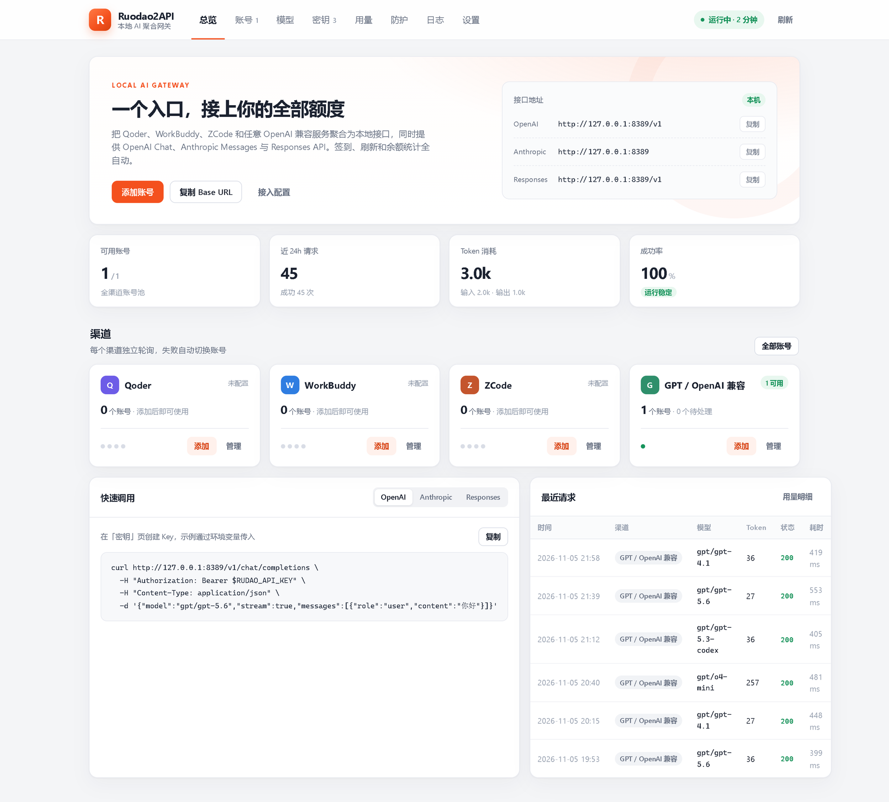
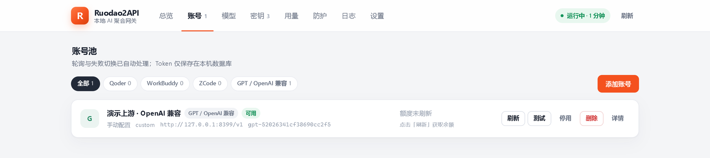
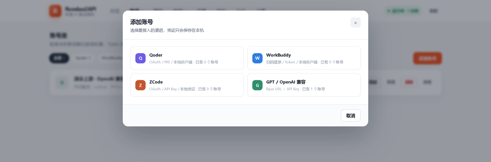
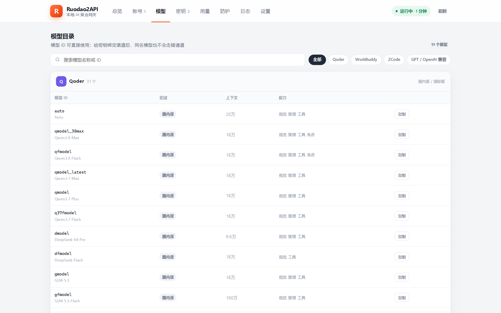
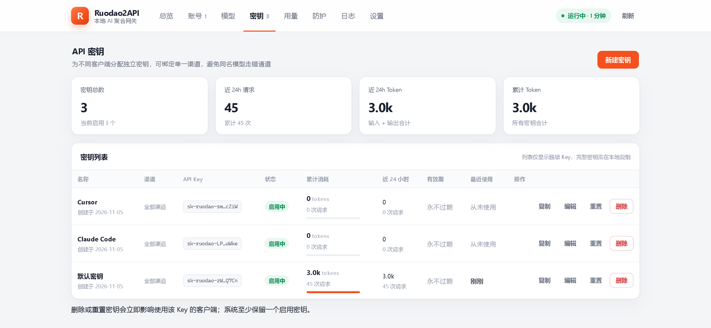
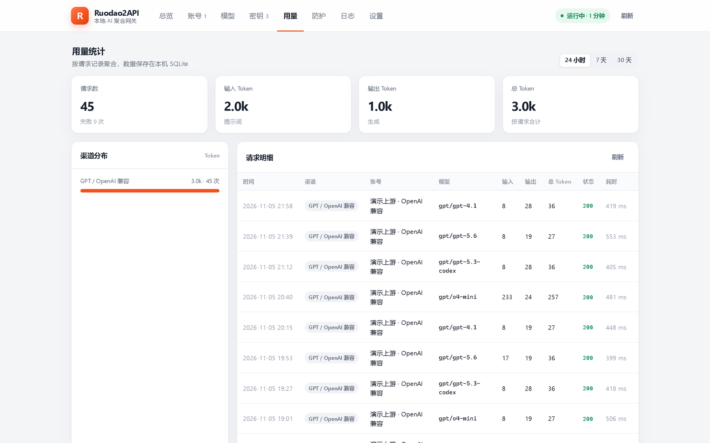
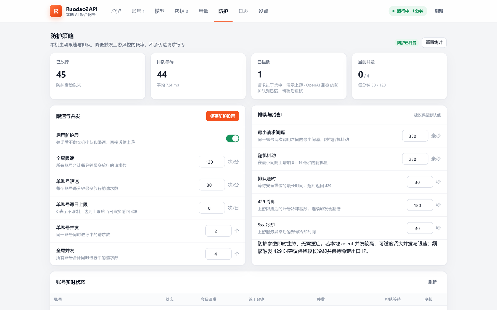
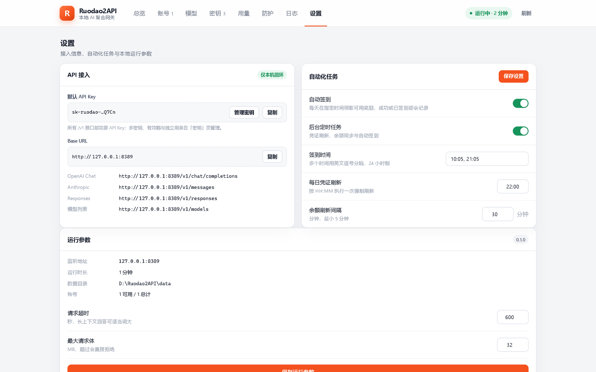

<div align="center">


# 若道 2API · Ruodao2API Manager

**把本机上的多个 AI 账号，聚合成一个 OpenAI / Anthropic 兼容接口**

Qoder · WorkBuddy · ZCode · 任意 OpenAI 兼容上游 —— 一个入口、一把密钥、一份用量账本

[](#系统要求)
[](#从源码运行)
[](#从源码运行)
[](#支持的接口)
[](LICENSE)

</div>

---

> ### ⚠️ 使用声明（请先读这一段）
>
> 本项目**仅供本机个人自用**：自己电脑上的自己的账号，自己聚合给自己用。
>
> - **不对外提供服务**：网关默认只监听 `127.0.0.1`，管理接口强制只允许本机回环访问。请不要把它暴露到公网、不要拿它开中转站或卖额度。
> - **不提供、不代充、不出售任何账号或凭证**：仓库里没有任何密钥，全部凭证都由使用者自己在本地填入，只写入本机 SQLite。
> - **风险自负**：自动签到、Token 刷新、请求转发都作用于第三方服务，是否符合对方用户协议、账号是否会被风控，由使用者自行判断与承担。
> - **禁止商用与二次分发**：不得将本项目（含修改版）用于商业用途、付费服务或打包分发。完整条款见 [LICENSE](LICENSE)。

---

## 📖 这是什么

手上同时有 Qoder、WorkBuddy、ZCode，又零散买了几个 OpenAI 兼容的第三方中转？于是日常变成这样：编辑器里配三套 Base URL，每套一份 Token；想知道今天烧了多少 Token，得挨个平台翻账单；某个账号额度用光了，客户端只会甩给你一个 429；签到靠手动点，忘了就断签。

Ruodao2API 把这些收进一个**跑在本机的小网关**：

- **一个入口**：`http://127.0.0.1:8388/v1` 就是全部模型，OpenAI 协议、Anthropic 协议、Responses 协议三种入口同源；
- **一份密钥**：给你的每个客户端（Cursor、Claude Code、Cherry Studio…）发一把 `sk-ruodao-` 密钥，可绑定单一渠道，互不串号；
- **一本账**：每次请求的渠道、账号、模型、输入/输出 Token、耗时、状态码都写进本地 SQLite，用量页直接看；
- **一层防护**：本机限速、排队、并发约束与失败冷却，降低把上游打出 429 的概率，但不伪造任何请求行为；
- **一套自动化**：定时签到、定时刷新凭证、定时拉余额，全部在本机进程里跑，不需要常驻云端。

整个过程**没有云端、没有中转服务器、没有账号托管**——只有你电脑上的一个 `python app.py`。

---

## 🖼️ 界面预览

> 截图取自**本地演示实例**：上游是一个在本机回环地址运行的模拟 OpenAI 服务，因此画面里没有任何真实账号、真实密钥或真实额度。

**总览：一个入口 + 渠道卡片 + 最近请求**



<table>
<tr>
<td width="50%"><br /><sub><b>账号池</b>：按渠道分组、独立轮询，失败自动切换</sub></td>
<td width="50%"><br /><sub><b>添加账号</b>：四种渠道，凭证只落本机</sub></td>
</tr>
<tr>
<td><br /><sub><b>模型目录</b>：90+ 条模型，模型 ID 可直接用</sub></td>
<td><br /><sub><b>密钥管理</b>：分客户端签发、可绑定渠道、可设有效期</sub></td>
</tr>
<tr>
<td><br /><sub><b>用量统计</b>：请求明细精确到单次调用</sub></td>
<td><br /><sub><b>防护策略</b>：限速、排队、并发、冷却全部可调</sub></td>
</tr>
</table>

**设置：接入信息、自动化任务、运行参数**



---

## ✨ 功能特性

### 四个渠道，一份接口

| 渠道 | 接入方式 | 自动签到 | 额度查询 | 说明 |
| --- | --- | --- | --- | --- |
| **Qoder** | OAuth 设备码 / PAT / 读取本地客户端凭证 | ✅ | ✅ | 国内版与国际版分别维护模型目录 |
| **WorkBuddy**（CodeBuddy） | 扫码登录 / Access Token / 导入本地客户端 | ✅ | ✅ | 国内版与国际版 |
| **ZCode** | OAuth / API Key / JWT | ✅ | ✅ | Z.AI coding-plan 额度 |
| **GPT / OpenAI 兼容** | Base URL + API Key（+ 自定义模型表、模型映射、额外请求头） | — | — | 第三方中转、自建 vLLM / Ollama 网关都能接 |

### 协议与路由

- **OpenAI**：`POST /v1/chat/completions`（流式 / 非流式，含 `tools`、`reasoning` 等参数透传）
- **Anthropic**：`POST /v1/messages`、`POST /v1/messages/count_tokens`（Claude Code 可直接指向本网关）
- **Responses**：`POST /v1/responses`（支持 `previous_response_id` 续接）
- **模型目录**：`GET /v1/models`、`GET /v1/models/{id}`
- **鉴权头**：`Authorization: Bearer …`、`x-api-key`、`api-key` 三种都认

模型 ID 支持三种写法，同一个模型可以按渠道精确指定：

```
gpt-5.6              # 直接写模型名，按候选渠道顺序尝试
gpt/gpt-5.6          # 渠道/模型：只走 GPT 兼容渠道
codebuddy/cn/gpt-5.6 # 渠道/区域/模型：只走 WorkBuddy 国内版
```

### 账号池与故障处理

- **轮询 + 亲和**：同一条会话（同一 `user` / 首条消息指纹）优先复用同一账号，减少上下文错位；
- **自动切换**：单渠道最多重试 3 个候选账号，失败即换，客户端只看到一次请求；
- **冷却**：上游 429 冷却 180 秒、5xx 冷却 30 秒，冷却中的账号不再被选中；
- **凭证续期**：Refresh Token / OAuth 到期前自动刷新，失败会记日志并在面板标红。

### 防护层（本机侧）

| 参数 | 默认 | 作用 |
| --- | --- | --- |
| 全局限速 | 120 次/分 | 所有账号合计的请求上限 |
| 单账号限速 | 30 次/分 | 避免单账号被上游盯上 |
| 单账号并发 / 全局并发 | 2 / 4 | 同时进行中的请求数 |
| 最小请求间隔 | 350 ms（+0~250 ms 抖动） | 把突发流量摊平 |
| 队列超时 | 30 s | 排队太久直接回 429，不让客户端干等 |
| 429 / 5xx 冷却 | 180 s / 30 s | 触发后该账号自动退避 |

> 防护层做的是**降低本机请求节奏**，不是绕过上游限制。它不会伪造请求头、不会模拟多人流量。

### 其它

- **桌面端**：Electron 窗口 + 托盘，双击即用；`--gui` 还可打开 Tk 管理窗口；
- **零第三方依赖**：后端只用 Python 标准库（`http.server` + `sqlite3` + `tkinter`）；
- **打包**：`python build.py` 一条命令产出后端 EXE、便携版 EXE 与 NSIS 安装包；
- **数据自持**：账号、密钥、用量、日志全部在本机数据库，随时可删可备份。

---

## 🚀 快速开始

### 系统要求

- Windows 10 / 11 x64（桌面端与 Tk 管理窗口为 Windows 专用）
- 从源码运行需要 Python 3.9+（**无需 pip install**，标准库足够）

### 方式一：从源码运行（最快上手）

```bash
git clone https://github.com/ruodaoai/ruodao2api-manager.git
cd ruodao2api-manager
python app.py            # 启动网关 + Tk 管理窗口
python app.py --open     # 启动后自动打开网页面板
python app.py --headless # 只跑网关，不要窗口（适合开机自启）
```

首次启动会在 `data/config.json` 里自动生成一把 `sk-ruodao-…` 主密钥，并在 `data/ruodao.db` 建库。

### 方式二：打包成 EXE（想要双击即用）

```bash
python build.py              # 后端 EXE + 便携版 + 安装包
python build.py portable     # 只出便携版
python build.py installer    # 只出 NSIS 安装包
```

产物：`dist/Ruodao2API-backend.exe`、`dist-electron/Ruodao2API.exe`、`dist-electron/Ruodao2API-Setup-0.1.0.exe`。

便携版 `Ruodao2API.exe` 放到任意目录双击即可，首次启动会：

1. 在 `%APPDATA%\Ruodao2API\data` 创建配置与 SQLite 数据库（可用 `RUDAO_DATA_DIR` 改到别处）；
2. 拉起后端并占用 `127.0.0.1:8388`（若被占用会自动顺延到 8389、8390…）；
3. 打开管理窗口。

> **仓库不提交任何二进制产物**（体积与签名原因）：请用上面两条命令在自己的机器上产出 EXE。

---

## 📘 使用教程

下面是完整走一遍的最短路径，逐步配图与排错见 **[docs/USAGE.md](docs/USAGE.md)**。

### 第 1 步：把账号加进来

打开面板 → **账号** → **添加账号** → 选渠道：

- **Qoder / WorkBuddy / ZCode**：优先用扫码 / OAuth 登录（按钮会拉起浏览器或二维码），也可以粘贴 Access Token / PAT / API Key；
- **GPT / OpenAI 兼容**：填 `Base URL`（到 `/v1` 为止即可）+ `API Key`，可选填模型列表与模型映射。

添加成功后卡片会显示「可用」，`额度未刷新` 的话点一下 **刷新** 即可拉取余额。

### 第 2 步：给客户端签发密钥

**密钥** → **新建密钥** → 起个名字（如 `Cursor`、`Claude Code`）。可以：

- **绑定渠道**：这把密钥只能走指定渠道，避免同名模型走错上游；
- **设置有效期**：到期自动失效；
- 完整密钥只在创建时显示一次，之后列表里只留掩码，**请当场复制**。

### 第 3 步：把客户端指过来

所有客户端都填这两项：

```
Base URL : http://127.0.0.1:8388/v1
API Key  : sk-ruodao-xxxxxxxx（第 2 步签发的）
```

<details>
<summary><b>OpenAI SDK / curl</b></summary>

```bash
curl http://127.0.0.1:8388/v1/chat/completions \
  -H "Authorization: Bearer $RUDAO_API_KEY" \
  -H "Content-Type: application/json" \
  -d '{"model":"gpt/gpt-5.6","stream":true,"messages":[{"role":"user","content":"你好"}]}'
```

```python
from openai import OpenAI

client = OpenAI(base_url="http://127.0.0.1:8388/v1", api_key="sk-ruodao-...")
print(client.chat.completions.create(
    model="gpt/gpt-5.6",
    messages=[{"role": "user", "content": "你好"}],
).choices[0].message.content)
```

</details>

<details>
<summary><b>Claude Code（走 Anthropic 协议）</b></summary>

```bash
# PowerShell
$env:ANTHROPIC_BASE_URL = "http://127.0.0.1:8388"
$env:ANTHROPIC_AUTH_TOKEN = "sk-ruodao-..."
claude
```

`ANTHROPIC_BASE_URL` 不要带 `/v1`，Claude Code 会自己拼 `/v1/messages`。

</details>

<details>
<summary><b>Cursor / Cherry Studio / ChatBox 等 GUI 客户端</b></summary>

在「自定义 OpenAI 兼容服务」里填：

- Base URL：`http://127.0.0.1:8388/v1`
- API Key：`sk-ruodao-...`
- 模型：先在面板 **模型** 页搜到目标模型，把它的 **模型 ID** 原样填进客户端（带斜杠的 ID 也能识别）。

</details>

### 第 4 步：看账、调节奏

- **用量**：按 24 小时 / 7 天 / 30 天看请求数、输入输出 Token、渠道分布、单次明细；
- **防护**：请求频繁被 429，就把「单账号限速」调低、把「最小请求间隔」调大；本机 agent 并发高，就适度调大并发与队列超时；
- **日志**：签到、刷新、上游错误、请求记录都在这里，出问题先看 **错误** 筛选。

### 第 5 步：自动化（可选）

设置页可以开：

- **自动签到**：默认 `10:05, 21:05`（24 小时制，英文逗号分隔，支持多个时间点）；
- **后台定时任务**：凭证刷新（默认 `22:00`）+ 余额同步（默认每 30 分钟）；
- 也可以命令行手动跑一次签到：`python app.py --checkin`

---

## 🔌 支持的接口

| 方法 | 路径 | 说明 |
| --- | --- | --- |
| `POST` | `/v1/chat/completions`、`/chat/completions` | OpenAI Chat Completions，支持流式 |
| `POST` | `/v1/messages`、`/messages` | Anthropic Messages，支持 `thinking`、`tools` |
| `POST` | `/v1/messages/count_tokens` | Token 预估 |
| `POST` | `/v1/responses`、`/responses` | OpenAI Responses，支持 `previous_response_id` |
| `GET` | `/v1/models`、`/v1/models/{id}` | 聚合模型目录 |
| `GET` | `/health` | 健康检查（无需鉴权） |
| `GET` | `/` | 网页面板 |
| `*` | `/api/*` | 管理接口，**仅回环地址**，写操作需 `X-Ruodao-Admin: 1` |

---

## 🖥️ 命令行参数

```text
python app.py [选项]

--host HOST        监听地址，默认 127.0.0.1
--port PORT        监听端口，默认 8388
--gui              启动 Tk 管理窗口（Windows）
--headless         只跑网关，不打开任何窗口
--open             启动后打开网页面板
--no-scheduler     不启动定时签到 / 刷新任务
--checkin          立即执行一次签到后退出
--version          版本号
```

环境变量：`RUDAO_DATA_DIR`（数据目录）、`RUDAO_HOST`、`RUDAO_PORT`、`RUDAO_API_KEY`。

---

## 🗂️ 目录结构

```text
ruodao2api-manager/
├── app.py                  # 入口：解析参数、拉起网关或管理窗口
├── build.py                # 一键构建：PyInstaller + electron-builder
├── ruodao/
│   ├── gateway.py          # HTTP 网关：协议转换、路由、鉴权、SSE 转发
│   ├── channels/           # 渠道适配器：qoder / codebuddy / zcode / openai 兼容
│   ├── protocols/          # Anthropic、Responses ↔ OpenAI 互转
│   ├── guard.py            # 限速、排队、并发、冷却
│   ├── accounts.py         # 账号池：轮询、亲和、健康与额度
│   ├── apikeys.py          # 密钥签发与校验
│   ├── scheduler.py        # 定时签到 / 刷新 / 余额
│   ├── store.py            # SQLite：accounts / api_keys / usage / events
│   ├── gui.py              # Tk 管理窗口
│   └── qoder/              # 请求签名、指纹、模型目录
├── static/                 # 网页面板（原生 JS，无框架）
├── electron/               # 桌面端外壳（Electron）
├── docs/                   # 使用教程与截图
└── data/                   # 运行时生成：config.json + ruodao.db（不入库）
```

---

## 🔐 数据与隐私

- 所有凭证只写入本机 `data/ruodao.db`（SQLite），不上传任何服务器；
- 网页面板与 `/api/*` 仅限 `127.0.0.1` 访问，非回环请求一律 403；
- 日志与用量默认只记录渠道、模型、Token 数、耗时，不记录 prompt 正文与凭证；
- 备份 = 复制整个 `data/` 目录；重置 = 删掉 `data/` 重新启动（会生成新密钥）。

---

## ❓ 常见问题

<details>
<summary><b>端口 8388 被占用怎么办？</b></summary>

桌面端会自动顺延到 8389/8390；命令行可用 `python app.py --port 8390`。启动失败时 `data/ruodao-error.log` 里有完整堆栈。

</details>

<details>
<summary><b>客户端报 401 / 无效 API Key</b></summary>

密钥只在创建时完整显示一次。已经丢了就在 **密钥** 页点 **重置** 生成新值，再更新客户端配置；确认请求头是 `Authorization: Bearer sk-ruodao-...`。

</details>

<details>
<summary><b>报「渠道 X 没有可用账号」</b></summary>

该渠道没有已启用且凭证完整的账号。去 **账号** 页确认状态是「可用」而不是「需登录」；冷却中的账号会显示剩余秒数。

</details>

<details>
<summary><b>同名模型走错了渠道？</b></summary>

用带渠道前缀的模型 ID（`gpt/gpt-5.6`、`codebuddy/cn/gpt-5.6`），或者给密钥绑定渠道。

</details>

<details>
<summary><b>签到失败 / 额度不刷新</b></summary>

先看 **日志** 的「错误」筛选：多见于凭证过期（重新登录即可）或上游接口变更。签到开关、时间点都在 **设置** 页。

</details>

---

## 🧾 免责声明

1. 本项目为**个人本机自用工具**，仅用于把使用者本人合法持有的账号聚合到本地接口，方便自己电脑上的客户端统一调用。
2. 本项目**不提供任何账号、额度、代充或代理服务**，仓库与发行包中不含任何凭证。
3. 使用本项目可能触及第三方服务的使用条款。是否合规、账号是否受影响，**由使用者自行判断并承担全部后果**，作者不承担任何连带责任。
4. 本项目按「现状」提供，不承诺可用性、不承诺跟进上游接口变更、不提供任何形式的担保。
5. **禁止**将本项目用于商业用途、付费中转、二次分发或任何违反当地法律法规的场景。

若你不认同以上任一条，请不要使用本项目。

---

## 🔗 相关项目

- [ruodao-guard-desktop](https://github.com/ruodaoai/ruodao-guard-desktop) —— 本地优先的 Windows 安全与加速工具箱
- [ruodao-guard](https://github.com/ruodaoai/ruodao-guard) —— 若道桌面端里的轻量安全插件

<div align="center"><sub>仅为自己的电脑写的小工具。用得顺手就好。</sub></div>
