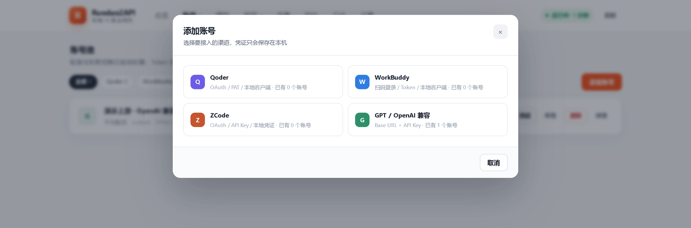
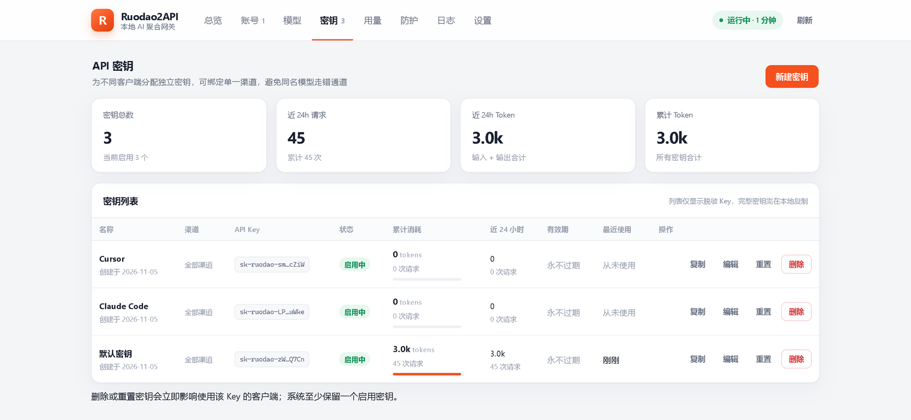
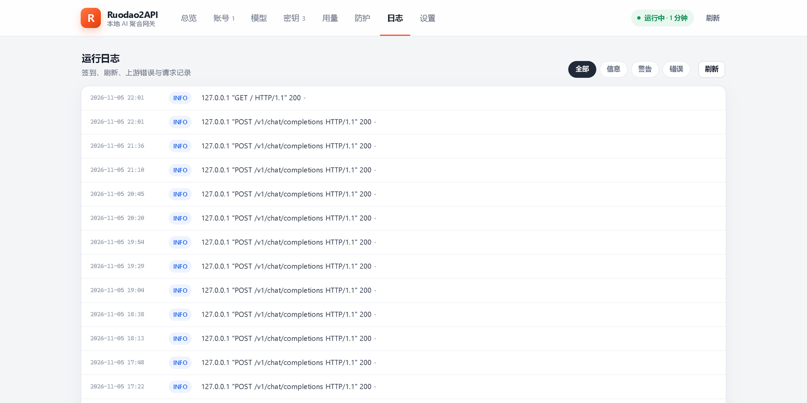

# Ruodao2API 使用教程

> 本文是 [README](../README.md) 的详细展开版：从装好到跑通第一条请求，再到调参、排错、备份。
> 全篇假设你只在本机自用——**不要把这个网关暴露到公网**。

## 目录

1. [安装与首次启动](#1-安装与首次启动)
2. [认识面板](#2-认识面板)
3. [接入账号](#3-接入账号)
4. [签发密钥](#4-签发密钥)
5. [客户端接入](#5-客户端接入)
6. [模型与路由规则](#6-模型与路由规则)
7. [防护层调参](#7-防护层调参)
8. [自动化任务](#8-自动化任务)
9. [用量与日志](#9-用量与日志)
10. [数据备份与重置](#10-数据备份与重置)
11. [排错手册](#11-排错手册)
12. [从源码构建](#12-从源码构建)

---

## 1. 安装与首次启动

### 1.1 三种装法

| 方式 | 适合谁 | 命令 |
| --- | --- | --- |
| 便携版 EXE | 只想用，不想装环境 | 双击 `Ruodao2API.exe` |
| 源码运行 | 想改代码 / 看实现 | `python app.py` |
| 自行构建 | 想要自己的二进制 | `python build.py` |

### 1.2 数据放哪

| 运行形态 | 数据目录 |
| --- | --- |
| 便携版 / 安装包（Electron） | `C:\Users\<你>\AppData\Roaming\Ruodao2API\data` |
| 后端 EXE 单独运行 | EXE 同级目录下的 `data\` |
| 源码运行 | 仓库根目录下的 `data\` |

想换位置就设环境变量：

```powershell
$env:RUDAO_DATA_DIR = "D:\Ruodao2API\data"
python app.py
```

`data\` 里有两个文件：`config.json`（运行参数 + 主密钥）、`ruodao.db`（账号、密钥、用量、日志）。

### 1.3 端口与首次启动

默认 `127.0.0.1:8388`。首次启动会自动：

1. 生成一把 `sk-ruodao-…` 主密钥写进 `config.json`；
2. 建立 SQLite 表结构；
3. 桌面端如果发现 8388 被占用，会依次尝试 8389、8390…，实际端口在面板右上角和设置页都能看到。

启动失败时，错误堆栈写在 `data\ruodao-error.log`，也会弹窗提示。

### 1.4 开机自启（可选）

后端不需要窗口也能跑：

```powershell
pythonw app.py --headless
```

把这条命令做成「任务计划程序」的登录触发器即可；只想跑网关、不做自动签到再加 `--no-scheduler`。

---

## 2. 认识面板

浏览器打开 `http://127.0.0.1:8388`（或用桌面端窗口），顶部八个页签：

| 页签 | 用途 |
| --- | --- |
| **总览** | 可用账号数、24 小时请求量、Token 消耗、成功率；渠道卡片；快速调用示例；最近请求 |
| **账号** | 增删改账号、刷新额度、测试连通性、启用/停用 |
| **模型** | 聚合后的模型目录，可按渠道筛选、搜索、一键复制模型 ID |
| **密钥** | 给客户端签发 `sk-ruodao-` 密钥、绑定渠道、设有效期、重置、删除 |
| **用量** | 24 小时 / 7 天 / 30 天的请求与 Token 统计、渠道分布、逐条明细 |
| **防护** | 限速、并发、排队、冷却参数，以及每个账号的实时状态 |
| **日志** | 签到、刷新、上游错误、请求记录，可按级别筛选 |
| **设置** | 接入地址、自动化任务、监听地址、超时、请求体上限 |

> 面板里的写操作都带 `X-Ruodao-Admin: 1` 头，且只允许 `127.0.0.1` 访问。用别的机器访问会直接 403。

---

## 3. 接入账号

**账号 → 添加账号**，先选渠道。



### 3.1 Qoder

三种方式，按顺手程度排序：

1. **OAuth 登录**（推荐）：点登录，按提示在浏览器完成授权，回调后自动落库；
2. **PAT**：在 Qoder 个人设置里生成以 `pt-` 开头的个人访问令牌，粘进「Access Token / PAT」；
3. **导入本地凭证**：本机装了 Qoder 客户端并已登录时，点 **扫描本地凭证** → 选一条 → 导入。扫描是只读的，不会改动客户端文件。

国内版与国际版要分别添加（同一个渠道下可以有多个账号，面板按 `渠道/区域` 分组）。

### 3.2 WorkBuddy（CodeBuddy）

1. **扫码登录**：点登录后出现二维码，用 WorkBuddy App 扫；
2. **Access Token**：从客户端登录态里取 `accessToken` 粘贴，填了 Refresh Token 就能自动续期；
3. **导入本地凭证**：本机装了 WorkBuddy 客户端时直接扫描导入。

企业版账号可额外填 `Domain`、`Enterprise ID`。

### 3.3 ZCode

填其中一种即可：

- **API Key**（推荐）：形如 `keyId.secret`，用于推理与 coding-plan 额度；
- **OAuth Access Token**：可换取 API Key；
- **JWT Token**：用于余额查询与签到。

### 3.4 GPT / OpenAI 兼容

```
Base URL : https://api.example.com/v1     # 填到 /v1 为止即可，多写 /chat/completions 会被自动裁掉
API Key  : sk-xxxx
名称      : 随便起，用于区分上游
模型列表   : 可选，一行一个；不填则自动向上游 /models 拉取
模型映射   : 可选，把上游不认的名字映射过去
额外请求头 : 可选，JSON，给需要特殊 header 的中转用
```

### 3.5 账号卡片上的按钮

| 按钮 | 做什么 |
| --- | --- |
| **刷新** | 强制刷新凭证并同步余额/额度 |
| **测试** | 用该账号发一次最小请求，验证连通性 |
| **停用 / 启用** | 临时从轮询里摘掉，不删数据 |
| **删除** | 连同凭证一起删掉 |
| **详情** | 看完整的字段、最近一次错误与额度快照 |

状态含义：**可用**（凭证正常）、**需登录**（凭证缺失或失效）、**冷却中**（429/5xx 退避）。

---

## 4. 签发密钥

**密钥 → 新建密钥**：



- **名称**：写清楚给谁用（`Cursor`、`Claude Code`、`obsidian`…），用量页会按名字聚合；
- **绑定渠道**：选了就只允许走该渠道，同名模型不会串到别的上游；
- **有效期**：留空为永久，到期自动失效；
- **完整密钥只显示一次**，列表里永远是掩码（如 `sk-ruodao-LP…uWke`）。丢了就点 **重置** 换新的。

> 系统至少保留一把启用密钥——删到最后一把会被拦下来，避免把自己锁在门外。

---

## 5. 客户端接入

统一两个值：

```
Base URL : http://127.0.0.1:8388/v1
API Key  : sk-ruodao-xxxxxxxx
```

### 5.1 先确认网关活着

```bash
curl http://127.0.0.1:8388/health
# {"status":"ok","version":"0.1.0","time":1793886956}
```

### 5.2 OpenAI 协议

```bash
export RUDAO_API_KEY=sk-ruodao-xxxxxxxx

# 模型列表
curl http://127.0.0.1:8388/v1/models -H "Authorization: Bearer $RUDAO_API_KEY"

# 流式对话
curl -N http://127.0.0.1:8388/v1/chat/completions \
  -H "Authorization: Bearer $RUDAO_API_KEY" \
  -H "Content-Type: application/json" \
  -d '{"model":"gpt/gpt-5.6","stream":true,"messages":[{"role":"user","content":"你好"}]}'
```

```python
from openai import OpenAI

client = OpenAI(base_url="http://127.0.0.1:8388/v1", api_key="sk-ruodao-xxxxxxxx")

for chunk in client.chat.completions.create(
    model="gpt/gpt-5.6",
    messages=[{"role": "user", "content": "用一句话解释 SSE"}],
    stream=True,
):
    if chunk.choices and chunk.choices[0].delta.content:
        print(chunk.choices[0].delta.content, end="")
```

### 5.3 Anthropic 协议（Claude Code）

```powershell
$env:ANTHROPIC_BASE_URL = "http://127.0.0.1:8388"      # 注意：不要带 /v1
$env:ANTHROPIC_AUTH_TOKEN = "sk-ruodao-xxxxxxxx"
claude
```

网关会认 `Authorization`、`x-api-key`、`api-key` 三种头，并自动把 Anthropic 请求体转成内部格式、再把结果转回 Anthropic 结构（含 `tool_use`、`thinking`）。

### 5.4 Responses 协议

```bash
curl http://127.0.0.1:8388/v1/responses \
  -H "Authorization: Bearer $RUDAO_API_KEY" -H "Content-Type: application/json" \
  -d '{"model":"gpt/gpt-5.6","input":"你好"}'
```

支持 `previous_response_id` 续接上下文（保存在内存，重启后失效）。

### 5.5 GUI 客户端

**Cursor / Cherry Studio / ChatBox / Continue / LobeChat** 等，凡是支持「自定义 OpenAI 兼容接口」的，都是填上面两个值 + 模型 ID。常见坑：

- Base URL 有的客户端要求带 `/v1`，有的自己补 `/v1` —— 两者都试一次，先看它请求的 URL 对不对；
- 模型名必须和 **模型** 页显示的 ID 一致（含斜杠），大小写敏感；
- 客户端如果强制校验模型列表，先在 `/v1/models` 里确认能拿到。

---

## 6. 模型与路由规则

### 6.1 模型 ID 三种写法

| 写法 | 含义 | 例子 |
| --- | --- | --- |
| `模型名` | 按候选顺序尝试，命中即用 | `gpt-5.6` |
| `渠道/模型名` | 只走指定渠道 | `gpt/gpt-5.6`、`codebuddy/gpt-5.6` |
| `渠道/区域/模型名` | 只走指定渠道的指定版本 | `codebuddy/cn/gpt-5.6` |

渠道名：`qoder`、`codebuddy`、`zcode`、`gpt`。区域名：`qoder/codebuddy` 用 `cn`/`intl`，`zcode` 用 `zai`/`global`，`gpt` 自定义上游通常不用区域。

### 6.2 一次请求内部发生了什么

```
客户端 → 鉴权（密钥有效？绑定渠道？）
       → 解析模型 ID → 候选账号列表（可用、未冷却、支持该模型）
       → 防护层排队（限速 / 并发 / 最小间隔）
       → 选中账号（会话亲和优先）→ 渠道适配器转换请求
       → 上游 SSE / JSON → 转回客户端要求的协议
       → 写 usage + 更新账号额度（失败则换下一个账号，最多 3 个）
```

要点：

- **亲和**：同一会话（`user` 字段或首条消息指纹）尽量复用同一账号，避免上下文断片；账号挂了才会切换；
- **重试**：只在候选账号之间换，不会把同一条请求重复打到同一个已失败的账号上；
- **流中断**：客户端断开时请求按 499 记账，不会误判为上游失败。

---

## 7. 防护层调参

防护层的目的只有一句话：**让本机发出的请求节奏像个正常人**，别把上游打出 429。

| 参数 | 默认 | 调大的后果 | 什么时候调 |
| --- | --- | --- | --- |
| 全局限速 `guard_global_rpm` | 120 次/分 | 更能扛并发，也更容易触发上游限制 | 多个 agent 同时跑 |
| 单账号限速 `guard_account_rpm` | 30 次/分 | 单账号承压更大 | 账号额度充足、请求密度低 |
| 单账号并发 `guard_max_concurrency` | 2 | 单账号同时跑更多流 | 长对话多、每次都很慢 |
| 全局并发 `guard_global_concurrency` | 4 | 整体吞吐更高 | 本机性能与上游都够 |
| 最小间隔 `guard_min_interval_ms` | 350 ms | 请求更密 | 频繁 429 时**调大**，不是调小 |
| 抖动 `guard_jitter_ms` | 250 ms | 更不可预测的间隔 | 一般不用动 |
| 排队超时 `guard_queue_timeout` | 30 s | 排队更久才回 429 | 客户端能容忍长等待 |
| 429 冷却 `guard_cooldown_429` | 180 s | 账号退避更久 | 上游风控较严 |
| 5xx 冷却 `guard_cooldown_5xx` | 30 s | 上游抖动时更保守 | 上游不稳定 |

三个典型场景：

- **一个人 + 一个客户端**：保持默认即可；
- **一个人 + 多个 agent（Claude Code + Cursor 同时跑）**：全局并发调到 6~8，单账号并发 2，其余不动；
- **经常吃 429**：单账号限速降到 15~20，最小间隔提到 600~900 ms，429 冷却加到 300 s。

所有参数**实时生效，不用重启**。防护页的「重置统计」只清计数，不改参数。

> 注意：防护层不伪造请求头、不模拟多人流量、不改出口 IP。它只是把你自己的请求排个队。

---

## 8. 自动化任务

设置页三个开关：

| 项 | 默认 | 说明 |
| --- | --- | --- |
| 自动签到 | 开 | 每天在指定时间给支持的渠道签到（Qoder / WorkBuddy / ZCode） |
| 后台定时任务 | 开 | 凭证刷新 + 余额同步 + 自动签到调度 |
| 签到时间 | `10:05, 21:05` | 24 小时制，英文逗号分隔，可写多个时间点 |
| 每日凭证刷新 | `22:00` | 每天定点强制刷新一次凭证 |
| 余额刷新间隔 | 30 分钟 | 拉取各账号额度，最小 5 分钟 |

命令行版：

```bash
python app.py --checkin        # 立刻签一次，打印结果后退出
python app.py --no-scheduler   # 本次启动不跑定时任务
```

签到结果写在 **日志** 页（级别 `INFO`，搜「签到」）。同一时间点一天只触发一次，程序重启不会重复签。

---

## 9. 用量与日志

### 9.1 用量口径

- **请求数**：每成功或失败转发一次记一条；
- **输入 Token**：优先取上游返回的 `usage.prompt_tokens`，上游没给时按消息长度估算；
- **输出 Token**：同上，取 `usage.completion_tokens`；
- **错误数**：状态码 ≥ 400 计入，明细里能点开看错误文本；
- **耗时**：从收到请求到最后一个字节，流式请求也按首字节到结束计。

### 9.2 日志级别



| 级别 | 内容 |
| --- | --- |
| `INFO` | 启动、账号增删、签到、刷新、访问日志 |
| `WARN` | 可恢复的异常：某渠道模型读取失败、凭证即将过期 |
| `ERROR` | 上游报错、鉴权失败、协议转换异常 |

排错顺序永远是：**日志（错误）→ 账号状态 → 用量明细 → 防护页**。先看最后一次失败的错误文本，再看这个账号是不是在冷却。

---

## 10. 数据备份与重置

```powershell
# 备份（关掉程序后复制整个目录最稳妥）
Copy-Item -Recurse "$env:APPDATA\Ruodao2API\data" "D:\backup\ruodao2api-data"

# 迁移到另一台机器：把 data 目录复制到对应位置即可，密钥与账号原样带走
```

重置：

```powershell
# 只清空用量与日志（保留账号和密钥）——先退出程序，再执行：
python -c "import sqlite3;c=sqlite3.connect(r'data\ruodao.db');c.execute('DELETE FROM usage');c.execute('DELETE FROM events');c.commit()"

# 彻底重置（会重新生成主密钥，客户端需要改成新 Key）
Remove-Item -Recurse "$env:APPDATA\Ruodao2API\data"
```

> `data\` 不要提交到任何仓库，里面有明文凭证。仓库的 `.gitignore` 已经排除了它。

---

## 11. 排错手册

| 现象 | 可能原因 | 处理 |
| --- | --- | --- |
| 启动即退出，无窗口 | 端口被占用 / 打包文件被安全软件拦截 | 看 `data\ruodao-error.log`；`--port 8390` 换端口；把程序目录加入杀软白名单 |
| `401 invalid api key` | 密钥错、已重置、已过期 | 密钥页重置后更新客户端 |
| `403 管理接口仅允许本机访问` | 用别的主机名或 IP 访问面板 | 用 `127.0.0.1` 或 `localhost` 访问 |
| `403 缺少管理请求头` | 直接调 `/api/*` 写接口没带 `X-Ruodao-Admin: 1` | 加头，或干脆用面板操作 |
| `429 请求过于频繁` | 触发了本机防护的限速/排队超时 | 调大间隔与限速，或等冷却结束 |
| `503 渠道 X 没有可用账号` | 账号全部失效/停用/冷却 | 账号页刷新、重新登录，或等冷却 |
| `502 连接上游失败` | 上游不可达、代理、DNS | 测试按钮验证；检查系统代理是否劫持了 `127.0.0.1` |
| 流式输出卡住不结束 | 上游 SSE 未正常收尾 / 客户端不支持 `stream` | 先关掉 `stream` 试；看用量明细里该请求的状态码 |
| 模型列表为空 | 该渠道没有可用账号 | 至少配一个账号，模型目录才会展开 |
| 签到总是失败 | 凭证过期或上游接口变更 | 重新登录；看日志里的 HTTP 状态与返回体 |

---

## 12. 从源码构建

```bash
# 后端（PyInstaller，会在 .build/venv 里装 pyinstaller）
python build.py

# 只出便携版 / 只出安装包
python build.py portable
python build.py installer
```

依赖：Python 3.9+、Node.js 18+（仅打桌面端时需要，`electron/` 下会自动 `npm install`）。

产物：

```
dist\Ruodao2API-backend.exe            # 后端（--windowed，双击是 Tk 管理窗口）
dist-electron\Ruodao2API.exe           # 便携版
dist-electron\Ruodao2API-Setup-*.exe   # NSIS 安装包
```

构建时若提示 `dist\Ruodao2API-backend.exe 正被占用`，说明还有 Ruodao2API 进程在跑，退出后重试。

---

## 附：几条使用建议

1. **一个客户端一把密钥**。用量能分开看，泄露了也只影响一把。
2. **给不同用途绑定不同渠道**。写代码的走编码模型渠道，长文写作走便宜渠道，互不抢额度。
3. **别关签到**。签到给的额度往往比日常消耗多，断签比限速更亏。
4. **升级前先备份 `data\`**。账号凭证只在本地，丢了要重新登录。
5. **它是给自己用的**。不要把端口开到 `0.0.0.0`，不要挂到公网，不要分享密钥。
